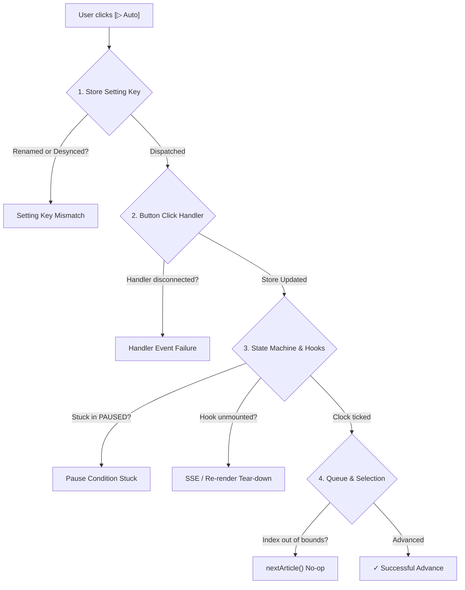
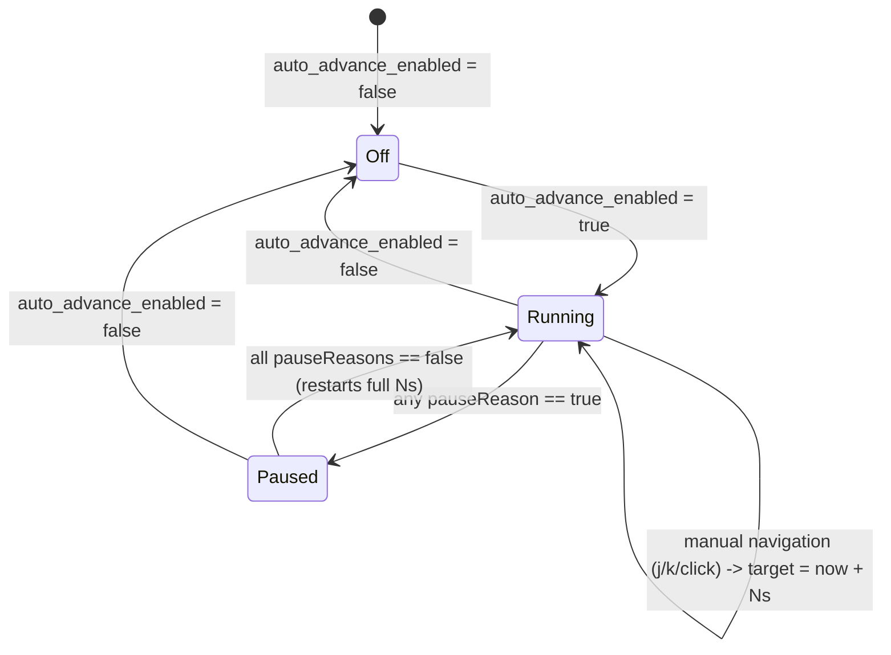

# Auto-Advance Subsystem: Diagnostic Specification & Architecture Blueprint
*Version 1.0 · 2026-11-11 · AI World News Desk (PRD D)*

---

## 1. Problem Statement

In the current broadsheet application, the **7-second Auto-Advance** feature is inactive (`OFF` by default), and activating the **[▷ Auto (7s)]** button does not successfully initiate story progression. 

The goal of Category 1 is to perform a rigorous, code-level root cause analysis across the entire settings, state, timer, and UI pipeline without making ad-hoc workarounds. Category 2 will then implement the permanent, clock-driven state machine.

---

## 2. Root Cause Investigation Matrix

The investigation focuses on eight potential failure domains:



### Domain 1: Stored Setting Value & Key Consistency
- **Audit Target**: `frontend/src/store/useAppStore.ts`, `backend/src/routes/settings.ts`, `backend/src/db/settings.ts`, and `frontend/src/components/settings/UnifiedSettingsDialog.tsx`.
- **Inquiry**: When settings were refactored into the 11-section `UnifiedSettingsDialog` during PRD C, did any property key get altered or misaligned?
  - Expected canonical keys:
    - `auto_advance_enabled` (boolean / '0'/'1')
    - `auto_advance_interval_sec` (number 3–60)
    - `auto_advance_pause_on_hover` (boolean / '0'/'1')
- **Check**: Verify whether `updateSettings` in `useAppStore` pushes both to the local store and sends a PUT request to `/api/settings`. Verify if optimistic updates immediately reflect in UI subscribers.

### Domain 2: Auto Button Click Handlers
- **Audit Target**: `TopBar.tsx` (`#btn-auto-advance-toggle`), `StatusStrip.tsx`, and `CommandPalette.tsx`.
- **Inquiry**: Does clicking the button toggle `settings.auto_advance_enabled`, or is the click handler intercepted, disabled, or mutating a detached local state?

### Domain 3: Timer & State Machine Lifecycle
- **Audit Target**: `frontend/src/components/layout/AutoAdvanceProgressBar.tsx` and `frontend/src/components/layout/Shell.tsx`.
- **Inquiry**: Is the timer loop executing via `setInterval` / `requestAnimationFrame`, or is it failing to initialize on mount because a prerequisite condition evaluates to falsy?

### Domain 4: Pause Reasons & Stuck Flags
- **Audit Target**: All pause condition flags:
  1. `isArticlePanelHovered`: Mouse hovering over the left reading pane.
  2. `isSettingsOpen`: Unified Settings Dialog open.
  3. `isCategoryViewOpen`: Category Rail / Directory view open.
  4. `isTvViewOpen`: TV Desk open.
  5. `isWorldMapOpen`: 3D Globe open.
  6. `isLibraryOpen`: The Library open.
  7. `isMissedNewsOpen`: Welcome back catch-up modal open.
  8. `isInputFocused`: Search wire or filter text inputs focused.
  9. `document.hidden`: Tab minimized or backgrounded.
  10. `isAutoAdvanceManualPaused`: User spacebar pause toggle.
- **Inquiry**: Are any of these flags stuck `true` at application startup (e.g. an invisible modal overlay or an unreleased hover listener)?

### Domain 5: SSE & Parent Re-render Interference
- **Audit Target**: Ingestion SSE events (`/api/sse`) and top-level re-renders in `Shell.tsx`.
- **Inquiry**: Does each incoming news batch or session heartbeat re-render `Shell.tsx` or re-instantiate `AutoAdvanceProgressBar`, resetting its countdown progress to zero before reaching 7 seconds?

### Domain 6: Plain Mode & Status Strip Interactions
- **Audit Target**: Layout collapsing when `plain_mode_enabled` is active.
- **Inquiry**: Does Plain Mode hide, detach, or bypass the auto-advance countdown hairline or store triggers?

### Domain 7: Queue Navigation Logic
- **Audit Target**: `nextArticle()` in `useAppStore.ts`.
- **Inquiry**: When the countdown completes, does `nextArticle()` successfully increment the active article index? Does it handle empty filtered lists or wrap-around cleanly?

### Domain 8: Browser Console & Runtime Exceptions
- **Audit Target**: Vitest unit tests and browser DevTools console logs during auto-advance execution.

---

## 3. Temporary Developer Debug Readout Design

In Category 1, a compact broadsheet debug HUD will be introduced behind the dev flag `?debug_auto=1` (or store toggle `devAutoAdvanceDebug`).

### Readout UI Wireframe

```
┌────────────────────────────────────────────────────────┐
│ [AUTO-ADVANCE DEBUG HUD]                               │
│ State: RUNNING | Time Left: 4.2s / 7.0s | Target: #42  │
│ Enabled: true | Hover Pause: true | Manual Pause: false│
│ Active Pause Reasons: [ NONE ]                         │
│ Queue: Index 3 of 124 (ID: 89) | Wrap-Around: OK       │
└────────────────────────────────────────────────────────┘
```

### Telemetry Points Monitored:
1. `enabled`: Boolean status from store and settings.
2. `interval`: Target interval in seconds (`auto_advance_interval_sec`).
3. `state`: Current state (`OFF` | `RUNNING` | `PAUSED`).
4. `active_pause_reasons`: Array of strings identifying all currently active pause triggers.
5. `elapsed_ms` / `remaining_ms`: Milliseconds calculated against wall-clock timestamp.
6. `target_article_id`: ID of the next article in line.

---

## 4. Proposed State Machine Architecture (Category 2 Blueprint)

To eliminate the fragility of tick-based intervals, the auto-advance engine will be rebuilt as a **Timestamp-Driven State Machine**:



### Real-Clock Invariants:
1. **Target Deadline**: `targetTimestamp = Date.now() + (intervalSec * 1000)`.
2. **Remaining Calculation**: `remainingMs = Math.max(0, targetTimestamp - Date.now())`.
3. **Sleep/Wake Recovery**: When the browser resumes after sleep or a frozen background tab, `Date.now() >= targetTimestamp`. Rather than executing a burst of multiple rapid advances, the state machine executes **exactly one advance** and resets `targetTimestamp = Date.now() + (intervalSec * 1000)`.
4. **Pause Resumption**: While paused, elapsed progress freezes. When all pause reasons clear, the state machine restarts a full interval ($N$ seconds) to give the reader ample time to begin the new article.
