# Auto-Advance Subsystem: Diagnostic Report & Architecture Blueprint
*Version 2.0 (Category 1 Empirical Diagnosis Complete) · 2026-11-11 · AI World News Desk (PRD D)*

---

## 1. Executive Summary & Root Causes Ranked

In live application runtime, the **7-second Auto-Advance** starts `OFF` and multiple interacting defects cause clicking **Play / Auto** either to remain stuck in a hidden pause state or to immediately halt after normal desk navigation. **No application fixes have been applied in Category 1** (diagnosis + temporary `?debug_auto=1` HUD only).

| Rank | Root Cause | Mechanism & File Evidence | Impact |
| :--- | :--- | :--- | :--- |
| **RC-1 (Critical)** | **Status Strip Play Button Deadlock (`isAutoAdvanceManualPaused` Trap)** | `StatusStrip.tsx:221-230` renders a `<Play>` icon on `#btn-status-strip-play-pause` whenever `!isEnabled \|\| isAutoAdvanceManualPaused`, yet its `onClick` ONLY calls `toggleAutoAdvanceManualPaused()`. Clicking Play (or pressing `Space` via `Shell.tsx:134`) while Auto-Advance is OFF silently flips `isAutoAdvanceManualPaused = true` while the strip still reads `Off`. Enabling TopBar `#btn-auto-advance-toggle` then lands immediately in `Paused: Manual pause` across repeated toggles. | Auto button turns ON in DB/TopBar yet appears dead (`Paused: Manual pause`); Play button never starts Auto-Advance from OFF. |
| **RC-2 (Critical)** | **Modal Close Leaves `currentView` Stuck in Non-Reader Mode (`Directory view` Trap)** | Opening overlays from `RightIconRail.tsx` (`249, 264, 291`), `BatMenuOverlay.tsx` (`79-125`), `CommandPalette.tsx` (`165, 176, 201`), or `SystemHealthIndicator.tsx` (`143`) calls `setCurrentView(view)` (`'tv'`, `'globe'`, `'control-room'`, `'settings'`, `'alerts'`, etc.). Closing those modals (`TVView.tsx:379,401`, `WorldMap.tsx:102,153,242`, `ControlRoomDesk.tsx:123,180,244`, `UnifiedSettingsDialog.tsx:277`, `AlertsCenter.tsx:71`, `ArchiveChat.tsx:42`, `WatchlistDesk.tsx:77`, `DailyPdfDesk.tsx:46`, `MorningBriefing.tsx:109`, `SourcesSettingsDesk.tsx:140`) only sets the modal boolean to `false` and **never resets `currentView` to `'reader'`**. Meanwhile `StatusStrip.tsx:115` treats any `currentView !== 'reader'` as `Paused: Directory view`. | After opening and closing TV, Globe, Control Room (or any Bat Menu view), Auto-Advance freezes permanently in `Paused: Directory view`. |
| **RC-3 (High)** | **Plain Mode Full-Width Hover Trap + Unreleased Hover Flag on Unmount** | Live settings default has `plain_mode_enabled: true`. In Plain Mode, `#reader-plain-mode-container` (`ArticlePanel`) spans `100%` of the desk (`1492×578 px` on `1536×864`). Dismissing any modal near center (`MissedNewsModal`, `UnifiedSettingsDialog`) or moving cursor anywhere into the workspace fires `ArticlePanel.tsx:173 onMouseEnter` → `Paused: Reading (hover)`. Worse, if `ArticlePanel` unmounts while hovered (switching to Directory view or toggling Plain Mode via shortcut/store without cursor exit), React does **not** fire `onMouseLeave`, leaving `isArticlePanelHovered` stuck `true` indefinitely. | Moving cursor almost anywhere over the reader—or unmounting while hovered—freezes countdown permanently in `Paused: Reading (hover)`. |
| **RC-4 (Medium)** | **Tick-Counting Timer Without Real-Clock State Machine or Unmount/Blur Recovery** | `StatusStrip.tsx:150-198` increments `elapsedMsRef.current += 100` inside `setInterval`. Timer is tick-counted rather than `Date.now()`-driven (sleep/wake stalls partial progress; pause resume continues stale interval phase instead of cleanly restarting full interval on unpause). Also `nextArticle()` (`useAppStore.ts:242`) double-increments `autoAdvanceResetToken` (once inside `setSelectedArticle` at line 316, again at line 242), and the active `setInterval` is not phase-restarted on reset. | Fragile timer cadence across sleep/wake/manual nav; `wasPausedRef` behavior inconsistent with full-interval restart contract. |
| **RC-5 (Medium)** | **Startup Catch-Up Modal + SSE Live Queue Mutation** | On downtime `>= 5` min (`9982m` gap observed at boot), `MissedNewsModal` mounts automatically (`isMissedNewsModalOpen: true`), activating `Paused: Catch-up open` and intercepting clicks. Separately, SSE `article_enriched_pass2` (`useSSE.ts:125`) invalidates `articles` queries and `addOrPrependArticle` mutates `state.articles` without a Queue Snapshot (addressed in Categories 2 & 5). | Blocks first interaction on boot if unacknowledged; live arrivals can shift queue indices mid-run. |

---

## 2. Systematic Evidence Across All 8 Required Domains

All runtime observations were collected using headless Chromium + Playwright (`1536×864`) against live dev servers (`http://localhost:5173` and `http://127.0.0.1:3001`) plus targeted static inspection. No DB rows were fabricated; `auto_advance_enabled` was restored to `false` after probing.

### Domain 1: Stored Setting Value & Key Consistency
- **Files Checked**: `backend/src/routes/settings.ts` (`SETTINGS_SCHEMA` lines 22–24, `SETTINGS_DEFAULTS` lines 321–323), `frontend/src/store/useAppStore.ts` (lines 430–432), `frontend/src/components/settings/UnifiedSettingsDialog.tsx` (`SECTION_DEFAULTS.reading` lines 155–157, Reading UI lines 662–708).
- **Evidence**:
  - `GET http://127.0.0.1:3001/api/settings` returned `{ auto_advance_enabled: false, auto_advance_interval_sec: 7, auto_advance_pause_on_hover: true, plain_mode_enabled: true }`.
  - All keys match verbatim (`auto_advance_enabled`, `auto_advance_interval_sec`, `auto_advance_pause_on_hover`). Nothing was renamed or dropped during the PRD C migration into `UnifiedSettingsDialog`.
  - **Verdict**: PASS (no key mismatch).

### Domain 2: Auto Button Click Handler & Setting Persistence
- **Files Checked**: `TopBar.tsx:118-138` (`#btn-auto-advance-toggle`), `UnifiedSettingsDialog.tsx:245-257, 662-663`, `CommandPalette.tsx:287`, `StatusStrip.tsx:221-230` (`#btn-status-strip-play-pause`).
- **Evidence**:
  - Clicking `#btn-auto-advance-toggle` invoked `updateSettings({ auto_advance_enabled: true })`, dispatching `PATCH /api/settings` -> HTTP `200` (`auto_advance_enabled=true`).
  - Clicking `#btn-status-strip-play-pause` when `auto_advance_enabled: false` displays a Play icon (`<Play size={10} />` via `{isAutoAdvanceManualPaused || !isEnabled ? <Play /> : <Pause />}`) but ONLY runs `onClick={toggleAutoAdvanceManualPaused}`.
  - Live probe (`diagnose-auto-advance.cjs` Test A):
    - `A1` (after clicking StatusStrip Play when OFF): `auto_advance_enabled: false`, `isAutoAdvanceManualPaused: true`, StatusStrip text: `Off`.
    - `A2` (after then clicking TopBar Auto): `auto_advance_enabled: true`, `isAutoAdvanceManualPaused: true`, StatusStrip text: `PAUSED (⏸ Paused: Manual pause)`. Story ID stayed `313222` indefinitely.
  - **Verdict**: **FAIL (Root Cause RC-1)**.

### Domain 3: Timer & State Machine Lifecycle
- **Files Checked**: `StatusStrip.tsx:56-198`, `AutoAdvanceProgressBar.tsx` (lines 1–235; verified **unmounted legacy file** superseded by `StatusStrip.tsx`).
- **Evidence**:
  - With `isAutoAdvanceManualPaused: false`, `currentView: 'reader'`, no modals open, and mouse moved to `(10, 10)` outside `#reader-plain-mode-container`, clicking `#btn-auto-advance-toggle` ran countdown ticks (`▶ Advancing in 7s` -> `4s`) and advanced story `313222 -> 313223` within `8.0s` (`diagnose-auto-advance.cjs` Test B1–B3).
  - Countdown logic uses `setInterval(..., 100)` with `elapsedMsRef.current += 100` rather than wall-clock deadlines (`Date.now()`). If throttled or suspended, tick counting cannot recover cleanly on wake, and there is no unified `(off, running, paused(reasons[]))` state machine.
  - Note also an unrelated minor bug noticed in `CardStrip.tsx:261`: `['j', 'k', 'ArrowLeft', 'ArrowRight', ' '].includes(e.key.toLowerCase())` never matches `'ArrowLeft'`/`'ArrowRight'` due to `.toLowerCase()`.
  - **Verdict**: **FAIL (Root Cause RC-4)**.

### Domain 4: Pause Reasons & Stuck Flags Audit

| Pause Flag | Trigger Source | Live Test Outcome | Defect Found? |
| :--- | :--- | :--- | :--- |
| `isAutoAdvanceManualPaused` | `#btn-status-strip-play-pause` / `Space` key | Flipped `true` while OFF; blocked subsequent TopBar Auto start. | **YES (RC-1)** |
| `isArticlePanelHovered` | `ArticlePanel.tsx:173-174` (`onMouseEnter`/`onMouseLeave`) | Plain mode panel covers `x: 0..1492, y: 84..662` (`86%` of screen height). Unmounting `ArticlePanel` (`currentView = 'category'` without `mouseleave`) left `isArticlePanelHovered: true` even when cursor moved to `(10,10)` (`RETURNED TO reader -> Paused: Reading (hover)`). | **YES (RC-3)** |
| `currentView !== 'reader'` | TopBar Directory + `RightIconRail` + `BatMenuOverlay` + `CommandPalette` + `SystemHealthIndicator` | Opening + pressing `Escape` on TV (`currentView='tv'`), Globe (`'globe'`), and Control Room (`'control-room'`) left all 3 modal booleans `false` while `currentView` stayed stuck, locking strip in `Paused: Directory view`. Checked all close handlers across `TVView`, `WorldMap`, `ControlRoomDesk`, `AlertsCenter`, `ArchiveChat`, `WatchlistDesk`, `SourcesSettingsDesk`, `DailyPdfDesk`, `MorningBriefing`, `UnifiedSettingsDialog`: none reset `currentView` to `'reader'`. | **YES (RC-2)** |
| `isTabHidden` | `StatusStrip` `visibilitychange` (`document.visibilityState === 'hidden'`) | Entered `Paused: Background tab` and resumed `▶ Advancing in 7s` on `visible`. | Partial (`document.visibilityState` works; tick timer not wall-clock reset on wake — **RC-4**). |
| `isSettingsOpen` + other 10 modal booleans | Store flags (`isTvViewOpen`, `isGlobeOpen`, `isControlRoomOpen`, `isPdfOpen`, `isArchiveChatOpen`, `isAlertsOpen`, `isSourcesOpen`, `isWatchlistOpen`, `isBriefingOpen`, `isCommandPaletteOpen`, `isMissedNewsModalOpen`) | All boolean flags cleared cleanly on modal close. However `isMissedNewsModalOpen` auto-opened at startup (`9982m` downtime gap), showing `Paused: Catch-up open`. | Startup blocker (`RC-5`) |
| `isInputFocused` | `window` `focusin`/`focusout` in `StatusStrip.tsx` | Escaping `#settings-search-input` returned `activeElement` to `BODY` and cleared input pause (though plain-mode hover under cursor caught immediately if cursor inside panel). Direct DOM node removal without `Escape` should still be guarded via `document.activeElement` validation in Cat 2. | Guard needed in Cat 2 |
| Library (`/library`) | `App.tsx:21-26`, `LibraryRoot.tsx` | Conditionally unmounts `<Shell />` cleanly when `/library` is active; remounts fresh on return. | PASS |

### Domain 5: SSE & Live Re-render Interference
- **Files Checked**: `frontend/src/hooks/useSSE.ts:121-318`, `frontend/src/store/useAppStore.ts`.
- **Evidence**:
  - `StatusStrip` stays mounted inside `Shell.tsx` across SSE events (`feed_counter_update`, `control_room_update`, `quota_update`, `article_enriched_pass2`); incoming events do **not** unmount `StatusStrip` or clear `elapsedMsRef`.
  - However, `useSSE.ts:125` invalidates `queryKeys.articles.all` and `addOrPrependArticle` mutates `state.articles` directly while auto-advance is running (addressed via Queue Snapshot in Category 2/5).
  - **Verdict**: No unmount reset; Queue Snapshot needed (**RC-5**).

### Domain 6: Plain Mode, Status Strip & Bottom Strip Follow Interactions
- **Evidence**:
  - **Plain Mode (`plain_mode_enabled: true`)**: Renders `ArticlePanel` at `1492×578 px` vs `891×578 px` in Dual-Pane mode, making `Reading (hover)` cover almost the entire desk whenever `auto_advance_pause_on_hover` is `true` (confirmed in `ui-prd-d-cat1-debug-hud-off.png` where dismissing MissedNewsModal left `hovered=true`).
  - **Status Strip**: Single winning `else if` label hides simultaneous active pause reasons and labels all non-reader views `'Directory view'`.
  - **Bottom Strip Follow (`CardStrip.tsx:157-288`)**: Strictly downstream observer of `selectedArticleId`; does not block or reset auto-advance.
  - **(Portal Theme Finding for PRD D Cat 8)**: `frontend/index.html:2` has `<html lang="en" class="dark">`, while `<Shell data-theme={theme}>` scopes paper CSS variables inside `#root > div`. Any `document.body` portal without `data-theme={theme}` inherits Obsidian Night tokens (`#0E0C09`).

### Domain 7: Queue ("next" item) Logic
- **Files Checked**: `useAppStore.ts:232-267`.
- **Evidence**: Verified live via Playwright (`diagnose-edge-cases.cjs` Test 4): on 60 loaded articles (`firstId: 313222`, `lastId: 309305`), `nextArticle()` wrapped cleanly from index 59 (`309305`) back to index 0 (`313222`). `setSelectedArticle` (line 316) and `nextArticle` (line 242) redundantly call `triggerAutoAdvanceReset()` twice per advance.

### Domain 8: Console Errors & Build/Unit Checks
- **Console Errors**: `0` JS errors (`consoleErrors: []`) during Playwright runs (only benign Chromium `--use-gl=swiftshader` WebGL deprecation warnings).
- **Frontend Production Build (`tsc && vite build`) + Vitest**: Passed (`240` existing tests + `4` new HUD tests = `244` tests across `44` files).

---

## 3. Temporary Developer Debug HUD (`?debug_auto=1`)

Implemented in `frontend/src/components/dev/AutoAdvanceDebugHud.tsx` and mounted conditionally inside `StatusStrip.tsx` (hidden by default; activated via `?debug_auto=1`, `localStorage.dnews_debug_auto='1'`, or `settings.debug_logging=true`). Rendered via `createPortal` with `data-theme={theme}` at bottom-left above `CardStrip`.

Monitors in real time:
1. **`ENABLED`**: `true` / `false` (`settings.auto_advance_enabled`)
2. **`INTERVAL`**: Configured target seconds (`auto_advance_interval_sec`)
3. **`CURRENT STATE`**: `OFF` | `RUNNING` | `PAUSED (<winning strip reason>)`
4. **`PAUSE REASONS`**: Simultaneous array of **all** active triggers (plus raw `View: <currentView>`, bypassing `else if` masking)
5. **`NEXT ADVANCE`**: Live remaining time (`s`), interval (`s`), percentage, integer seconds
6. **`QUEUE` & `FLAGS`**: Current index / total, current → next article IDs, `hoverPause`, `hovered`, `plain`

Verified screenshots (`1536×864`):
- Default URL (without `?debug_auto=1`): `#auto-advance-debug-hud` count = `0`.
- `ui-prd-d-cat1-debug-hud-off.png`: OFF state clearly exposes `[Reading (hover)]` even while OFF (`hovered=true` over Plain Mode).
- `ui-prd-d-cat1-debug-hud-running.png`: Active RUNNING state (`4.7s / 7.0s (34%)`, `[NONE]`).
- `ui-prd-d-cat1-debug-hud-stuck-view.png`: Reproduces `RC-2` live after TV open + `Escape`, visibly showing `PAUSED (Directory view)` with `[View: tv]`.

---

## 4. Proposed Category 2 Permanent Fix Blueprint

```mermaid
stateDiagram-v2
    [*] --> Off: auto_advance_enabled = false
    Off --> Running: TopBar Auto / StatusStrip Play / Settings toggle -> clears manualPause
    Running --> Paused: activeReasons.length > 0
    Paused --> Running: activeReasons.length == 0 (deadline = now + intervalMs)
    Running --> Running: Date.now() >= deadline (1 advance; deadline = now + intervalMs)
    Running --> Off: auto_advance_enabled = false
    Paused --> Off: auto_advance_enabled = false
    Running --> Running: Manual nav (j/k/prev/next/click) -> deadline = now + intervalMs
```

### Concrete Changes Planned for Category 2 (Pending Approval):
1. **Extract Standalone Clock-Driven State Machine (`frontend/src/utils/autoAdvanceMachine.ts`)**:
   - Explicit state `{ status: 'off' | 'running' | 'paused', reasons: PauseReason[], deadlineMs: number | null, remainingMs: number }`.
   - Driven purely by `now = Date.now()` (`targetTimestamp = now + intervalSec * 1000`).
   - Any pause freezes `remainingMs` display, and clearing ALL pause reasons restarts a **full `N`-second interval** (`deadlineMs = now + intervalSec * 1000`).
   - Laptop sleep / frozen background tab: `Date.now() >= deadlineMs` executes **at most 1 advance** (never a burst) and schedules the next full interval on resume/wake.
2. **Fix Button Synchronization & Deadlock (`TopBar.tsx`, `StatusStrip.tsx`, `Shell.tsx`, `useAppStore.ts`)**:
   - Clicking `#btn-status-strip-play-pause` when `!auto_advance_enabled` turns `auto_advance_enabled = true` and ensures `isAutoAdvanceManualPaused = false`.
   - Turning `auto_advance_enabled` ON via TopBar `#btn-auto-advance-toggle`, `CommandPalette`, or `UnifiedSettingsDialog` ALWAYS clears stale `isAutoAdvanceManualPaused = false`.
   - Pressing `Space` only toggles `isAutoAdvanceManualPaused` when `auto_advance_enabled === true` (and ignores inputs).
3. **Fix Stuck `currentView` & Stuck `isArticlePanelHovered`**:
   - Reset `currentView` to `'reader'` when closing overlays opened via `BatMenuOverlay`/`RightIconRail`/`SystemHealthIndicator`/`CommandPalette` (only `'reader'` and `'category'` are full-page views; modal overlays should either not overwrite `currentView` or cleanly restore it to `'reader'` on close).
   - Map non-reader pause label accurately (e.g., `'Directory view'` only for `currentView === 'category'`, avoiding misleading `'Directory view'` for `'tv'`/`'globe'`).
   - Clear `isArticlePanelHovered = false` in a `useEffect` cleanup inside `ArticlePanel.tsx` whenever `ArticlePanel` unmounts, AND ignore hover pauses whenever `settings.auto_advance_pause_on_hover === false`.
   - Validate `isInputFocused` against live `document.activeElement` on focus/blur and modal closes so removed inputs can never trap pause state.
4. **Queue Snapshot & SSE Isolation**:
   - Keep active auto-advance queue isolated from background SSE invalidations/reorders (full multi-story pill flow arrives in Cat 5; Cat 2 guarantees SSE events never reset timer deadline or advance twice) and eliminate double `triggerAutoAdvanceReset()` calls in `nextArticle()`/`prevArticle()`.
5. **Comprehensive Test Suite & Dev Readout Cleanup**:
   - Vitest fake-clock & UI tests covering: toggle ON/OFF, every pause reason & simultaneous clearing, hover switch ON vs OFF, tab `hidden`/`visible`, laptop sleep simulation (`Date.now()` +2h jump -> single advance + full interval restart), 20 consecutive advances, wrap-around, and settings persistence.
   - Keep `?debug_auto=1` cleanly gated (or remove per user preference in Cat 2 review).
