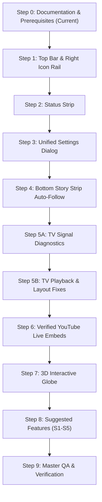

# PRD C: UI Fixes, TV Fixes & New 3D Globe
*Version 1.0 · 2026-11-03 · AI World News Desk*

---

## 1. Executive Summary & Context

PRD C addresses critical layout, usability, media playback, and cartographic enhancements identified across desktop viewports.
Previous milestones (**PRD A**: Main-App Upgrade and **PRD B**: The Library) have been completed, verified with automated test suites, and approved.

The core objectives of PRD C are:
1. **Top Bar & Navigation Rail**: Eliminate horizontal overflow by preserving only essential controls in the Top Bar and moving secondary actions, views, and modes to a dedicated vertical Icon Rail on the right edge of the workspace.
2. **Status Strip**: Replace the floating auto-advance bar that covered content with an in-flow, dedicated horizontal strip beneath the Top Bar.
3. **Unified Settings**: Consolidate all scattered settings, modals, and toggles into a single, accessible, tabbed Settings dialog with live search and persistent backend synchronization.
4. **Active Story Tracking**: Ensure the bottom news wire strip smoothly auto-scrolls to keep the actively selected or auto-advancing article centered in view.
5. **TV Playback & Diagnostics**: Diagnose and resolve stream playback failures, fix the HLS proxy for CORS/redirects, enforce strict playability health truth (a stream is only "LIVE" if it truly plays), implement a true 16:9 player frame, add a dedicated mute toggle with memory, and resolve Quick Switcher ambiguities.
6. **Verified YouTube Live Embeds**: Research and configure official YouTube live stream IDs for the Top 5 news channels in India, the United States, China, Japan, Australia, and nature streams.
7. **3D Interactive Globe**: Replace the flat, dim vector map with an interactive 3D globe powered by local geometry, broadsheet aesthetics, country-level data pins, wildlife layers, and automatic flat-map fallback.
8. **Suggested Additions (S1–S5)**: Implement high-value UX enhancements (Command Palette, Health Indicator, Layout Presets, TV Mini-Player, and Viewport Regression Tests).
9. **Master QA & Visual Validation**: Verify all changes across four mandatory desktop resolutions (1280x720, 1366x768, 1536x864, 1920x1080) in Paper and Night Edition themes.

---

## 2. Global Engineering Rules

- **G1. Docs First**: Complete architectural specifications (`/docs/PRD_C.md`, `/docs/LAYOUT_SPEC.md`, `/docs/SETTINGS_SPEC.md`, `/docs/TV_FIXES.md`, `/docs/GLOBE_SPEC.md`, `/docs/OPEN_QUESTIONS.md`, `/docs/PROGRESS.md`) before any code is written or modified.
- **G2. Never Guess**: When requirements are ambiguous, log the issue in `/docs/OPEN_QUESTIONS.md` and await user direction.
- **G3. Category-by-Category Execution**: Implement categories strictly in order (0, 1, 2, 3, 4, 5A, 5B, 6, 7, 8, 9). Stop and obtain explicit approval after each category.
- **G4. Database Safety**: Commit git changes and generate a full SQLite snapshot in `backups/` before starting and before any schema migration.
- **G5. Package Vetting**: Solicit approval before adding packages. Pin exact versions, ensure publication date > 14 days, run `npm audit`, record license (MIT/Apache/ISC/OFL only) in `CREDITS.md`.
- **G6. Skill Declaration**: Declare active skills per `GEMINI.md` prior to beginning each category.
- **G7. Localhost Only**: Restrict runtime to localhost desktop browser environments; no Electron or Tauri desktop packaging.
- **G8. Design System Integrity**: Rely exclusively on CSS variables from `DESIGN_SYSTEM.md`. Maintain WCAG AA contrast, reduced-motion preferences, and two-finger trackpad scrolling. Ensure complete isolation of The Library.
- **G9. Viewport Matrix**: Validate every layout change via automated Playwright screenshots across four resolutions in both Paper and Night themes:
  - 1280 × 720 (Small Desktop / HD)
  - 1366 × 768 (Standard Laptop)
  - 1536 × 864 (Medium HiDPI Laptop)
  - 1920 × 1080 (Full HD Monitor)

---

## 3. Category Specifications

### Category 1: Top Bar & Right Icon Rail (Issue 1)
- **Problem**: Right-aligned controls in the Top Bar overflow offscreen on viewports ≤ 1536px, cutting off critical controls.
- **Top Bar Contents**: Restricted strictly to:
  1. Masthead (Bat icon + "The World Desk" logotype)
  2. Region / Country Selector dropdown
  3. Directory View toggle button
  4. Breaking News filter toggle
  5. Auto-Advance quick toggle (`Auto (7s)`)
  6. Search Wire input field (shrinks first as viewport contracts; text labels collapse to icons before any button drops).
- **Right Icon Rail**: Fixed-width vertical icon bar docked on the far right edge of the workspace in the layout flow:
  - **Group (a) Live Status**: Live feed counter badge (with downward telemetry popover), Alerts bell with unread count.
  - **Group (b) Workspace Views**: TV Broadcast Wire (`t`), 3D Globe Radar (`g`), The Library (`l`), Control Room Desk (`c`).
  - **Group (c) Modes & Theme**: Plain Mode toggle (Zero AI), Theme switcher (Paper ↔ Night Edition).
  - **Group (d) Bottom Utilities**: Settings gear button (opens unified Settings Dialog, shortcut `,`).
- **Interaction**: Icon buttons with broadsheet tooltips; optional pin-open toggle; keyboard accessible with focus indicators; active view highlighted.
- **Moved Items**: "Gap: Xm" and "PLAIN MODE (ZERO AI)" pills move from Top Bar into the Status Strip.

### Category 2: Status Strip (Issue 4)
- **Problem**: The floating auto-advance bar covers the top portion of the article desk (headline, outlet, date stamps).
- **Solution**: Remove the floating container. Insert a dedicated horizontal bar ("Status Strip") directly under the Top Bar in standard document flow.
- **Contents**:
  - Auto-advance status label (`▶ Advancing in Xs` or `⏸ Paused: <reason>`)
  - 2px hairline countdown progress bar
  - Play/Pause quick button
  - Gap badge chip (`Gap: Xm`) when recovery window is detected
  - Plain mode status chip (`Plain: ON`)
  - Optional System Health summary dot (Category 8)
- **Geometry**: Compact height (approx. 28px), styled with `--color-paper-alt` and `--color-paper-border`, guaranteeing zero overlap with ArticlePanel or SummaryPanel.

### Category 3: Unified Settings Button & Dialog (Issue 5)
- **Problem**: Settings are dispersed across the Bat Menu drawer, Top Bar buttons, and subpage modals.
- **Solution**: Provide a primary Settings button at the bottom of the Right Icon Rail (shortcut `,`) opening a full modal dialog.
- **Dialog Architecture**:
  - Modal with backdrop blur, focus trap, and Escape key dismissal.
  - Left navigation sidebar listing 11 categorized sections.
  - Top live search box ("Search settings...") filtering options across all sections.
  - Right scrollable content pane with broadsheet controls (toggles, sliders, selects, inputs).
- **11 Sections**:
  1. General
  2. Reading
  3. News and Sources
  4. AI and Plain mode
  5. TV Broadcasts
  6. Map & Globe
  7. Alerts & Audio
  8. Appearance & Typography
  9. Data, Backups & Storage
  10. Library Archives
  11. Advanced & Developer
- **Features**: Autosave with toast confirmation, per-section "Reset to defaults", restart-required notices, zero export of secret API keys, real SQLite backend persistence via `/api/settings`.

### Category 4: Bottom Story Strip Follows Current News (Issue 6)
- **Problem**: When changing articles via auto-advance, keyboard (`j`/`k`), or clicking, the bottom `CardStrip` does not scroll to reflect the active story.
- **Solution**:
  - Implement an auto-follow observer in `CardStrip.tsx` that smoothly centers the active card in the horizontal track when `selectedArticleId` updates.
  - Seamless wrap-around handling: after the last article, scroll smoothly back to the first.
  - Manual scroll override: if the user scrolls or drags the strip, pause auto-follow for 4 seconds, then resume without fighting user gestures.
  - Setting toggle: add "Follow current story in strip" under Settings > Reading.
  - Accessibility: respect `prefers-reduced-motion` (instant jump instead of smooth transition).

### Category 5: TV Diagnostics & Playback Fix (Issue 2)
- **Step 5A (Diagnosis Only)**:
  - Probe all 28 current channels using an automated diagnostic script testing HLS proxy and YouTube embed availability.
  - Generate an audit table capturing channel name, streaming method, pass/fail result, HTTP status, and exact failure reason (CORS, 403 Forbidden, 404 Not Found, geo-restriction, mixed content, timeout, invalid manifest, proxy error).
  - Submit findings to user for review before making code modifications.
- **Step 5B (Playback Remediation)**:
  - **Health Truth**: Only assign "LIVE" status to channels that pass end-to-end playability verification (manifest parses, media segment decodes, or YouTube reports playback). Unreachable channels are categorized into "FAULTY FEEDS" or "STOPPED LINKS".
  - **HLS Proxy**: Enhance `backend/src/tv/proxy.ts` to support nested playlist parsing, chunk URL rewriting, header forwarding (User-Agent, Referer), and HTTP redirect handling while maintaining SSRF guards.
  - **Frame Geometry**: Lock player container to a strict 16:9 aspect ratio (`aspect-video`) that scales cleanly with resizable panels.
  - **Channel List**: Ensure channel list fills its container with smooth scrolling, multiline/truncated titles with tooltips, country flags, and clear health text.
  - **Quick Switcher**: Disambiguate duplicate names by displaying `Name (Country)`.
  - **Dedicated Mute & Audio Control**: Add standalone speaker icon toggle next to volume slider, support `m` keyboard shortcut, persist volume and mute state, display "Click to unmute" hint for autoplay compliance.
  - **Error Actions Panel**: Include fallback options: Try YouTube, Open in VLC, Skip to Next, Retry Signal, Report Dead Link.

### Category 6: YouTube Live Embeds for Top Channels (Issue 2)
- **Objective**: Identify and verify official YouTube live streams for the Top 5 outlets in India, USA, China, Japan, and Australia, plus nature webcams.
- **Methodology**:
  - Rely exclusively on official channel links from verified broadcaster websites; zero unofficial or pirated re-streams.
  - Adopt official YouTube IFrame Player API standards for live broadcast embedding.
  - Verify embeddability via YouTube oEmbed API (`https://www.youtube.com/oembed?url=...`).
  - Store results in `/config/channels-top5.json` with status fields: `verified-playing`, `embedding-disabled`, `not-live`, or `needs my review`.
  - Present results table for user review prior to committing.

### Category 7: New 3D Interactive Globe (Issue 3)
- **Problem**: Current map is a flat, 2D Mercator/Equal Earth rendering with limited visual fidelity.
- **Solution**:
  - Implement a 3D interactive globe prototype using `react-globe.gl` (Three.js, MIT) and local TopoJSON data (`/countries-110m.json`).
  - Theme styling matching the broadsheet palette (Night Edition default with Paper mode alternative; subdued borders, soft atmospheric glow).
  - Data visualizations: country markers sized by news volume, crimson pins for wildlife dispatches, pulsing ripple rings for fresh dispatches (< 5m).
  - Interactivity: hover tooltips (country name, story count, latest headline), click-to-filter with camera fly-to animation, arc curves for multi-country stories.
  - Motion control: subtle auto-rotation that halts on user interaction and resumes after 8s idle; auto-rotation disabled when reduced motion is preferred.
  - Performance & Fallback: lazy load component, target 60 FPS, cap pixel ratio at 2.0, auto-switch to 2D `WorldMap` if WebGL is unavailable or FPS drops below 30. Retain a manual "Flat Map" toggle.

### Category 8 (Suggestions): S1–S5 Additions
- **S1. Command Palette (`Ctrl+K`)**: Fast search dialog for jumping to views, toggling modes, and accessing tools.
- **S2. System Health Indicator**: Tri-color status pill in the Status Strip reflecting overall health of RSS fetchers, AI pipeline, scheduler, and TV streams.
- **S3. Layout Presets**: One-click switching between "Reading Desk", "TV Monitor", and "Full Wire" panel configurations.
- **S4. TV Mini-Player**: Draggable floating picture-in-picture player when navigating away from TV View.
- **S5. Viewport Matrix Regression Suite**: Automated Playwright test verifying zero clipping, no layout overflow, and zero unexpected horizontal scrollbars across all 4 target viewports.

### Category 9: Master QA & Verification
- Full test suite execution across backend and frontend.
- Security audit verifying zero exposed API keys and strict SSRF defenses.
- Playwright screenshot capture across 4 viewports in Paper and Night Edition.
- Verification of design tokens and accessibility compliance.

---

## 4. Execution Sequence

*Each step requires approval before the next step commences.*

