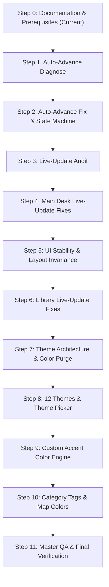

# PRD D: Auto-Advance Fix, Live-Update Audit & Theme System
*Version 1.0 · 2026-11-11 · AI World News Desk*

---

## 1. Executive Overview

PRD D focuses on three critical pillars of operational excellence and visual refinement for the AI World News Desk:
1. **Auto-Advance Reliability**: Complete root-cause diagnosis and robust re-architecture of the 7-second auto-advance mechanism into a timestamp-driven state machine that never gets stuck, respects user pause configurations, survives restarts, and handles tab sleep/wake seamlessly.
2. **Unified Live-Update Engine**: Comprehensive live-update audit across every surface of the Main Desk and The Library, culminating in a single typed Server-Sent Events (SSE) bus with message replay, event deduplication, throttled batching (2–30s), queue snapshot isolation, and zero scroll jumps or layout shifts.
3. **12-Theme Semantic Design System & Color Purge**: Complete eradication of hardcoded colors across the entire codebase in favor of semantic CSS custom properties, introducing 12 handcrafted broadsheet themes (5 Light, 6 Dark, 1 High Contrast AAA), a live-previewing theme gallery in Settings > Appearance, an auto-deriving custom accent generator with real-time contrast auditing, and dynamic cartographic/WebGL recoloring without page reloads.

---

## 2. Global Engineering Rules

- **G1. Docs First**: Complete architectural specifications (`/docs/PRD_D.md`, `/docs/LIVE_UPDATE_AUDIT.md`, `/docs/AUTO_ADVANCE_DEBUG.md`, `/docs/THEME_SPEC.md`, `/docs/OPEN_QUESTIONS.md`, `/docs/PROGRESS.md`) before any implementation code is written.
- **G2. Never Guess**: Ambiguous requirements are logged in `/docs/OPEN_QUESTIONS.md` and explicitly clarified with the user before proceeding.
- **G3. Category-by-Category Execution**: Implement categories strictly in order (0 through 11). Stop and obtain explicit user approval with test output and screenshots after each category.
- **G4. Safety Net Backups**: Verify a clean git commit and copy the SQLite database to `backups/` prior to starting and before any database modification.
- **G5. Package Vetting**: Solicit explicit user approval before adding packages. Prefer in-house zero-dependency algorithms for color math and contrast checks. If packages are required, enforce exact pinned versions published > 14 days ago, run `npm audit`, and record MIT/Apache/ISC/OFL licenses in `docs/CREDITS.md`.
- **G6. Skill Declaration**: Declare active skills per `GEMINI.md` prior to beginning each category.
- **G7. Localhost Only**: Restrict runtime to standard desktop browsers on localhost; no Electron or Tauri desktop wrappers.
- **G8. Test Data Isolation**: Test routines may ONLY touch isolated test databases (`news.test.sqlite`), never production data. Existing functional behaviors must have zero regressions.

---

## 3. Category Specifications

### Category 0: Documentation & Prerequisites (Current)
- Establish comprehensive architectural specifications:
  - `/docs/PRD_D.md` (this refined brief)
  - `/docs/AUTO_ADVANCE_DEBUG.md` (root-cause diagnosis framework & state machine blueprint)
  - `/docs/LIVE_UPDATE_AUDIT.md` (inventory of all 24 data surfaces and live-update test protocols)
  - `/docs/THEME_SPEC.md` (semantic tokens, 12 palettes, WCAG contrast equations, color purge rules)
  - `/docs/OPEN_QUESTIONS.md` (architectural questions logged for user direction)
  - `PROGRESS.md` (tracking table for PRD D steps 0–11)
- Verify pre-PRD D database snapshot in `backups/` and clean git state.

---

### Category 1: Auto-Advance Diagnose (Diagnosis Only)
- **Problem Statement**: The 7-second auto-advance feature is currently OFF, and pressing the Auto button does not initiate advance.
- **Investigation Matrix**:
  1. **Stored Setting Key & Persistence**: Audit `useAppStore.ts`, `settings.ts`, and `UnifiedSettingsDialog.tsx` to determine if setting keys (`auto_advance_enabled`, `auto_advance_interval_sec`, `auto_advance_pause_on_hover`) were renamed, detached, or lost during the PRD C settings reorganization.
  2. **Button Click Handlers**: Trace click handlers in `TopBar.tsx`, `StatusStrip.tsx`, and `CommandPalette.tsx` to verify dispatch to the store and backend settings API.
  3. **Timer & State Machine**: Audit `AutoAdvanceProgressBar.tsx` and `Shell.tsx` to see if the timer is stuck in a `paused` state or fails to start on mount.
  4. **Pause Flags Inspection**: Verify whether any pause condition is stuck `true`:
     - Hover over left reader panel (`isArticlePanelHovered`)
     - Modals open (`isSettingsOpen`, `isMissedNewsOpen`, `isLibraryOpen`, etc.)
     - Input/textarea focused (`isInputFocused`)
     - Document visibility / tab hidden (`document.hidden`)
     - Directory view or special views open (`isCategoryViewOpen`, `isTvViewOpen`, `isWorldMapOpen`)
  5. **SSE / Live Re-render Interference**: Determine if incoming server-sent events trigger parent component re-renders that reset or unmount the auto-advance countdown hook.
  6. **Plain Mode & Status Strip Interactions**: Determine if Plain Mode or bottom strip auto-centering interferes with countdown timers.
  7. **Queue Navigation & Boundaries**: Audit `nextArticle()` in `useAppStore.ts` for index wrap-around or empty list conditions.
  8. **Console Errors**: Capture all JavaScript runtime errors related to countdown hooks.
- **Deliverables**:
  - Add a temporary developer debug readout (behind a dev flag `?debug_auto=1`) displaying: `enabled`, `interval`, `state`, `active_pause_reasons[]`, and `time_to_next_advance_ms`.
  - Compile findings into `/docs/AUTO_ADVANCE_DEBUG.md` and await approval.

---

### Category 2: Auto-Advance Fix & State Machine Rebuild
- **Architecture**: Rebuild the auto-advance timer as a formal, deterministic state machine with real-clock timestamp calculations:
  - **States**: `OFF` | `RUNNING` | `PAUSED(reasons: PauseReason[])`
  - **Clock-Driven**: Driven by elapsed milliseconds since target deadline (`Date.now() >= targetTime`) rather than counting fragile `setInterval` ticks. Handles OS sleep/wake and background tab throttling gracefully without advance bursts.
- **Required Behaviors**:
  - Toggling Auto button instantly switches state and persists to backend settings; TopBar, Status Strip, and Settings Dialog remain strictly synchronized.
  - Status Strip displays live hairline countdown when `RUNNING`, and exact pause reason when `PAUSED` (clearing immediately when the reason ends and restarting a full interval).
  - Hover-pause setting obeyed: when ON, pauses while mouse is over left panel; when OFF, ignores hover.
  - Manual navigation (click, `j`/`k`, arrow keys) resets the timer to a full interval.
  - Tab wake / laptop resume restarts a full interval rather than burst-skipping.
- **Automated Tests**: Comprehensive Vitest suite validating state transitions, each pause reason, hover flag permutations, wake simulation, wrap-around, and 20 consecutive advances.

---

### Category 3: Live-Update Audit (Diagnosis Only)
- **Goal**: Inventory and benchmark live data propagation across all surfaces without page refresh or layout jumping.
- **Surfaces Monitored**:
  - **Main Desk**: Reader story fields, story cards, bottom strip, ticker, category counts, country filter, search, breaking alerts, alerts bell + unread count, live feed counter (24h/30d/all-time/sparkline), Gap chip, System Health indicator, Control Room (freshness, quotas, scheduler, errors), TV (channel health, Live/Faulty/Stopped lists, player), Globe pins, Compare Coverage, Story Timeline, Watchlist hits, Archive, cross-tab Settings sync, bookmarks.
  - **The Library**: Today-in-History feed, historical search, Wisdom (quotes/scriptures/daily verse), Mind Helps cards, bookmarks, license data, background refresh jobs.
- **Audit Method**: Automated Playwright test against test database injecting live articles, stat changes, channel health flips, and library records; measure latency, update mechanism (SSE / polling / none), and log PASS/FAIL.
- **Deliverable**: Detailed audit matrix in `/docs/LIVE_UPDATE_AUDIT.md`. Await approval.

---

### Category 4: Live-Update Fixes — Main Desk
- **Unified Real-Time Layer**:
  - Single SSE connection (`/api/sse`) managed by a central hook/store feeding all surfaces via a typed event bus.
  - Reconnection resilience: exponential backoff, event IDs, and `Last-Event-ID` cursor playback to recover missed events.
  - Client-side deduplication by unique item ID.
  - Broadsheet "Reconnecting..." pill in Status Strip (non-blocking).
- **Throttled Batching**:
  - Live data buffered and applied in smooth batches controlled by user setting ("Live refresh interval", default 5s, range 2–30s).
  - Layout-stable telemetry (Feed counter, Gap chip) updates immediately.
- **Memory & Virtualization**:
  - Cap in-memory collections, virtualize long lists, unsubscribe on unmount, and complete a 30-minute soak test with zero memory leaks.

---

### Category 5: UI Stability & Layout Invariance
- **Queue Snapshot Pattern**: The reading queue is a frozen snapshot of the active filter. Newly arriving articles accumulate in a broadsheet "● N new stories" pill. Clicking the pill or reaching queue wrap-around merges them into the active queue. Auto-advance never skips or reorders mid-read.
- **Zero Scroll Jumps**: Scroll anchoring guarantees active article, bottom strip position, and scrolled list offsets remain 100% frozen when data arrives.
- **Zero Layout Shifts**: Tabular numbers (`font-variant-numeric: tabular-nums`) for all counters and clocks; reserved dimensions for cards, images, and chips; fade-only animations for new rows.
- **Zero Component Remounts**: TV player, YouTube iframe, 3D Globe WebGL canvas, and form inputs are strictly memoized with stable keys.
- **Layout Shift Test**: Automated Playwright test verifying 0px bounding box movement on reading surfaces during live updates.

---

### Category 6: Live-Update Fixes — The Library
- Extend the unified real-time event bus to The Library while strictly respecting PRD B architectural isolation (`library_` database tables, `frontend/src/library/**`, `backend/src/library/**`).
- Real-time updates for Today-in-History entries, Wisdom scripture additions, Mind Helps cards, and cross-tab bookmark synchronization.
- Apply the same "N new items" pill pattern so active reading is never disturbed.
- Pixel-diff verification proving zero visual regressions on Main Desk screens.

---

### Category 7: Theme Architecture & Color Purge
- **Semantic CSS Token Dictionary**: Eradicate all raw hex, rgb, and arbitrary color classes across the application in favor of standardized CSS custom properties:
  - Base surfaces: `--bg`, `--surface`, `--surface-2`, `--border`
  - Typography: `--text`, `--text-muted`, `--text-on-accent`
  - Brand & Accents: `--accent`, `--accent-hover`, `--accent-text`, `--link`, `--focus`, `--selection`
  - Fixed Alerts: `--breaking` (strictly red-family across all themes with WCAG contrast tuning)
  - Categories: 11 semantic token pairs (`--cat-<name>-bg`, `--cat-<name>-fg`)
  - Cartography: 10 map tokens (`--map-ocean`, `--map-land`, `--map-border`, `--map-pin`, etc.)
  - The Library: Derived tokens (`--lib-*`) matching active theme warmth.
- **Codebase Color Purge**: Scan and replace all hardcoded colors across components, styles, Canvas, and Three.js materials.
- **Zero FOUC First-Paint**: Lightweight inline script in `index.html` applying cached theme before initial DOM paint.
- **Pixel-Diff Proof**: Prove "Classic Paper" and "Night Edition" remain 100% visually identical to their PRD C appearance.

---

### Category 8: The 12 Themes & Theme Picker
- **Handcrafted Theme Catalog (Manual Pick Only — No Auto Switching)**:
  - **Light Themes**: 1. Classic Paper, 2. Nordic Frost, 3. Mint Paper, 4. Desert Sand, 5. Sepia Library.
  - **Dark Themes**: 6. Night Edition, 7. Midnight Blue, 8. Forest Wildlife, 9. Ocean Teal, 10. Wine and Rose, 11. Amber Terminal.
  - **Accessibility Theme**: 12. High Contrast (pure black & white with yellow accent, AAA 7:1 standard).
- **Automated Contrast Engine**:
  - Enforces WCAG 2.1 AA (4.5:1 for normal text, 3:1 for large text/borders/icons).
  - `--text-on-accent` automatically computed (black or white) based on maximum relative contrast.
  - CI test script fails build if any token pair in any theme violates contrast rules.
- **Theme Picker UI**:
  - Settings > Appearance: Visual gallery of 12 theme cards with color swatches, sample text, and live hover preview.
  - Right Icon Rail: Quick theme switcher popover.
  - Command Palette: "Change theme..." action.
  - 200ms smooth cross-fade transition (`prefers-reduced-motion` instant).

---

### Category 9: Custom Accent Color Engine
- **"Custom" Theme Card**:
  - Native color input with hex field and HSL fine-tuning sliders (zero external npm packages).
  - Base selector: Light Base (Classic Paper), Dark Base (Night Edition), or any of the 12 presets.
- **Algorithmic Token Derivation**:
  - Automatically calculates `--accent-hover`, readable `--accent-text`, `--text-on-accent`, and tinted surfaces.
  - Live contrast scorecard: automatically clamps lightness if user picks an unreadable shade (e.g. near background).
  - Category tags and map hues preserve distinct identities, adapting only lightness/saturation to the chosen base.
  - Persisted in settings and exported in settings JSON.

---

### Category 10: Category Tags & Cartographic Recolor
- **11 Category Tag Token Pairs**:
  - Each broadsheet category (World, Politics, Business, Tech, Science, Health, Sports, Entertainment, Environment, Crime, Animals) receives a distinct, tuned color pair with >= 4.5:1 contrast across all 12 themes.
  - Dual encoding: color is paired with textual/iconographic indicators for accessibility.
- **Dynamic 3D Globe & Flat Map Recolor**:
  - WebGL globe materials and SVG flat map dynamically update uniforms and fills on theme change without camera reset or WebGL context re-instantiation.

---

### Category 11: Master QA & Final Verification
- **Screenshot Matrix**: High-resolution captures across all 12 themes + 1 custom theme at 1366×768 and 1920×1080.
- **Automated Regression Audits**:
  - Contrast math validation across every token pair.
  - Hardcoded color scanner (fails if raw colors exist outside theme token files).
  - Auto-advance 20-step verification test.
  - Live-update zero layout shift test.
  - Security audit and license compliance in `docs/CREDITS.md`.
- **Final Acceptance & Approval**.

---

## 4. Execution Sequence

*Every step requires automated test output, visual validation, documentation update, and explicit user approval before proceeding to the next step.*
