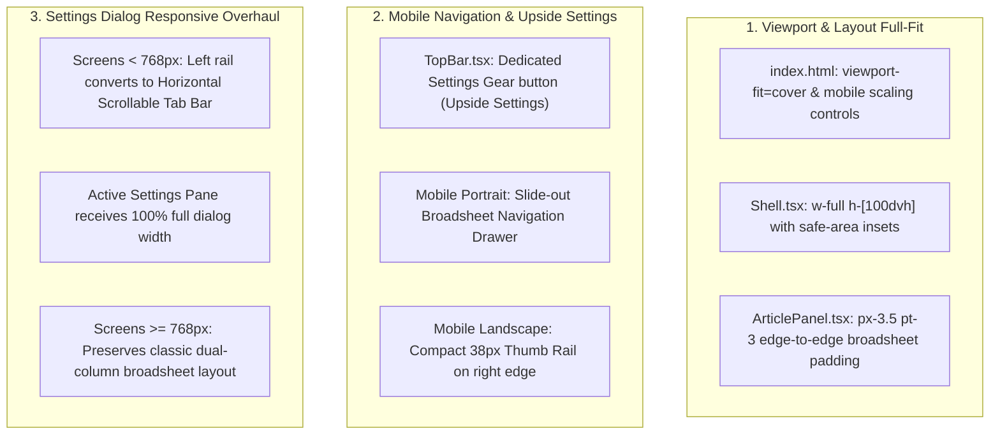

# PRD — Master Expansion Suite & Mobile Responsive Fixes (v1.0.8)

**Document Version**: 1.0.0  
**Date**: 2026-11-22  
**Status**: APPROVED & IN EXECUTION  
**Author**: Antigravity Full-Stack & UI Architecture Team  

---

## 1. Executive Summary & Architecture Strategy

This document establishes the comprehensive specification for DNews across two key objectives requested by the user:
1. **Immediate Execution (Phase A)**: Complete remediation of Mobile Viewport Full-Fit (edge-to-edge), TopBar Upside Settings Access, Mobile Navigation Drawer (Portrait), Compact Thumb Navigation (Landscape), and Responsive Full-Width Settings Dialog.
2. **Expansion Roadmap (Phases B, C, D)**: The detailed architectural blueprint for the 36 selected features across Mobile Gestures, Reading Innovations, AI Intelligence, Media Desks, and Security Hardening.

---

## 2. Phase A: Immediate Mobile Fixes Specification

### 2.1 Full-Fit Mobile Layout & Edge-to-Edge Broadsheet
- **HTML Meta**: Update `frontend/index.html` viewport to:
  `<meta name="viewport" content="width=device-width, initial-scale=1.0, maximum-scale=1.0, user-scalable=no, viewport-fit=cover" />`
- **Shell Dimensions**: In `Shell.tsx`, replace `w-screen h-screen` with `w-full h-[100dvh] max-w-full overflow-hidden`.
- **CSS Safe Areas**: Add utility insets in `global.css`:
  - `padding-top: env(safe-area-inset-top, 0px)`
  - `padding-bottom: env(safe-area-inset-bottom, 0px)`
  - `padding-left: env(safe-area-inset-left, 0px)`
  - `padding-right: env(safe-area-inset-right, 0px)`
- **Article Padding**: Calibrate `ArticlePanel.tsx` mobile padding from `px-6 pt-6` down to `px-3.5 sm:px-8 lg:px-16 pt-3 sm:pt-6` so news dispatches expand cleanly to screen edges without dead white margins.

### 2.2 TopBar "Upside Settings" & Mobile Navigation Access
- **TopBar Settings Button**:
  Add an explicit Settings icon button (`Sliders` / `Settings` icon) in `TopBar.tsx` beside the breaking and auto-advance toggles.
  - Visible on all screen sizes (mobile portrait, landscape, desktop).
  - Tapping immediately triggers `useAppStore.getState().setSettingsOpen(true)`.
- **Mobile Navigation Drawer (Portrait < 768px)**:
  Tapping the Bat Masthead icon on mobile unfolds a slide-out broadsheet navigation drawer containing cards for all 12 desks:
  - Reading Desk (`reader`)
  - 3D Globe (`globe`)
  - Newsroom TV (`tv`)
  - Archive & Search (`archive`)
  - Editorial Compare (`compare`)
  - Timeline (`timeline`)
  - Watchlist (`watchlist`)
  - Alerts Center (`alerts`)
  - PDF Desk (`pdf`)
  - Morning Briefing (`briefing`)
  - Control Room (`control-room`)
  - Library (`library`)
- **Compact Thumb Rail (Landscape Mobile)**:
  In landscape orientation on mobile ($h < 500\text{px}$ or $w < 900\text{px}$), render a slim 38px vertical icon rail on the right margin so users can navigate between desks with their thumb.

### 2.3 Unified Settings Dialog (100% Full Width on Mobile)
- In `UnifiedSettingsDialog.tsx`:
  - On screens $< 768\text{px}$:
    - The fixed `w-64` left sidebar transforms into a **horizontal scrolling category tab bar** placed directly beneath the masthead header.
    - The active settings pane (`main.flex-1`) receives **100% full width** of the dialog container.
    - All inputs, server URL boxes, sliders, checkboxes, and update buttons render comfortably without any horizontal clipping or squishing.
  - On desktop screens ($\ge 768\text{px}$):
    - Retains the two-column broadsheet layout (`w-64` vertical sidebar + flexible right pane).

---

## 3. Roadmap for the 36 Selected Upgrades

The 36 selected user features are partitioned into 3 subsequent architectural waves:

### Phase B: Mobile Gestures & Broadsheet Reading Innovations
- **#1 Pull-to-Refresh**: Broadsheet rubber ink-stamp animation triggering live feed polling.
- **#2 Swipe-to-Glide**: Horizontal page-turn gesture between articles in full-screen reader.
- **#3 Haptics**: Native vibration pulses on bookmarking, card snap, and pull-to-refresh.
- **#4 Bottom Navigation Bar**: Quick-access thumb bar for mobile portrait.
- **#6 Adaptive Notch & Island**: Dynamic styling around Android punch-holes and camera cutouts.
- **#8 App Shortcuts**: Android home screen long-press quick launcher shortcuts.
- **#9 Printable Front Page PDF**: Export a 1920s-style multi-column front-page newspaper.
- **#10 Bionic Speed-Reading**: Toggle to bold word stems for high-speed comprehension.
- **#12 In-Line Glossary**: Tooltip explanations for international terms and acronyms.
- **#13 Margin Notes & Highlighting**: Ink highlighter and marginalia saved to SQLite.
- **#14 Typography Studio**: Custom serif font families, column widths, and line-heights.
- **#15 Reading Tracker**: Daily read counts, reading time, and topic distribution.
- **#16 Editorial Cartoon**: Daily syndicated satirical cartoon in halftone newsprint style.

### Phase C: AI Intelligence, Media & Ingestion Pipeline
- **#17 Bias Radar**: Multi-perspective visual spectrum analyzing framing across outlets.
- **#18 Two-Tier Summaries**: Toggle between 2-bullet executive brief vs. in-depth background.
- **#20 Entities Relationship Map**: Interactive canvas graph of people, nations, and treaties.
- **#21 Claim Corroboration**: Cross-checking facts across 3+ independent global wires.
- **#24 Semantic Vector Search**: Embeddings-based conceptual search across dispatches.
- **#31 Photojournalism Desk**: High-resolution gallery celebrating award-winning press photography.
- **#32 Custom RSS Studio**: In-app UI to add, test, and syndicate custom user feeds.
- **#34 Syndication Deduplication**: Merging multi-paper reprints of identical wire stories.
- **#35 Background Ingestion with Internet**: Periodic background fetch on Wi-Fi and mobile data.
- **#36 Source Health & Expanded Feeds**: Live latency scoreboard + 30 new global publications.

### Phase D: Knowledge Archive & Security Hardening
- **#38 Sunday Edition Magazine**: Curated weekly synthesis of major investigative stories.
- **#39 Saved Knowledge Mind-Map**: Graph visualization connecting saved articles and quotes.
- **#40 Obsidian / Notion Export**: Markdown export with YAML metadata and pull-quotes.
- **#41 On This Day in History**: Historical front pages and headlines from 50, 100, 150 years ago.
- **#42 Wisdom Spaced Repetition**: Flashcard review for philosophy quotes and vocabulary.
- **#43 Zero-Tracking Shield**: Stripping UTM tokens, tracking pixels, and referrers from links.
- **#44 Encrypted SQLite Database**: SQLCipher / AES-256 database encryption at rest.
- **#45 Hardware Security Module**: Storing AI API keys in Windows Credential Manager / Android Keystore.
- **#46 Tor / SOCKS5 Proxy**: Routing RSS traffic through anonymity networks for censored regions.
- **#47 Sanitized CSP Shield**: Strict Content Security Policy preventing malicious script injection.
- **#48 Decentralized IPFS Archival**: Distributed immutable backups for historical news dispatches.
- **#49 Incognito Reading Desk**: Private mode leaving zero trace in read history or session logs.
- **#50 Secure Wipe Panic Button**: Instant multi-pass shredding of database, cache, and keys.

---

## 4. Verification Plan for Phase A
1. **Mobile Portrait (390x844)**:
   - Verify `viewport-fit=cover` eliminates dead space on top/sides.
   - Verify Settings Gear icon is visible in TopBar and opens `UnifiedSettingsDialog`.
   - Verify Settings Dialog shows horizontal tabs and 100% full-width active settings pane.
   - Verify Mobile Navigation Drawer opens and all 12 desks are reachable.
2. **Mobile Landscape (844x390)**:
   - Verify compact thumb rail appears on right edge with all desks clickable.
   - Verify article reader utilizes horizontal space efficiently.
3. **Desktop (1440x900)**:
   - Verify broadsheet layout, top bar, and two-column settings dialog remain pristine.
4. **Automated Visual Validation**:
   - Capture Playwright screenshots into artifacts for visual sign-off.
