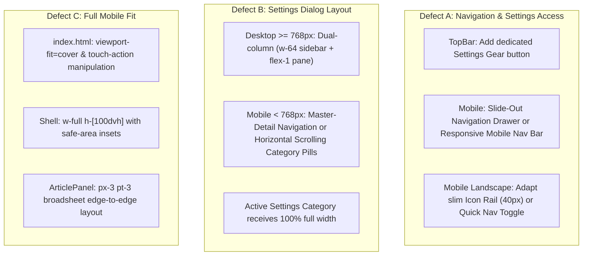

# PRD — Mobile Viewport Full-Fit, Unified Settings & Navigation Adaptation (v1.0.8)

**Document Version**: 1.0.0  
**Date**: 2026-11-22  
**Status**: PROPOSED FOR USER REVIEW & APPROVAL (DO NOT CODE YET)  
**Author**: Antigravity UI Architecture Team  

---

## 1. Executive Summary & Defect Diagnosis

This Product Requirements Document addresses three core usability defects discovered when running DNews on mobile devices (Android APK & mobile browser Viewports in portrait and landscape):

### 1.1 Defect A: Missing "Side Options" and "Upside Settings" on Mobile Portrait & Landscape
- **Root Cause**:
  - `RightIconRail.tsx` (which holds navigation for Reader, Globe, TV, Archive, Compare, Timeline, Watchlist, Alerts, PDF, Briefing, Control Room, Library, and Settings) is coded with `hidden md:flex`. Consequently, on all mobile phone viewports ($< 768\text{px}$), the side options rail is completely hidden in both portrait (e.g., 390px) and landscape (e.g., 640px–720px).
  - `TopBar.tsx` contains region filter, directory toggle, breaking filter, auto-advance, and search, but **lacks an explicit Settings gear button**. Desktop users relied on `RightIconRail` or keyboard shortcut `b` to open settings, neither of which is accessible on a mobile touch screen.
- **Impact**: Mobile users cannot access application settings or switch to major views (TV, Globe, Archive, Timeline, Library, Watchlist, PDF Briefing).

### 1.2 Defect B: Unified Settings Dialog Sidebar Crushing the Focused Settings Content
- **Root Cause**:
  - In `UnifiedSettingsDialog.tsx`, the modal layout is a two-column split:
    - Left sidebar: `<aside className="w-64 border-r ...">` (fixed **256px** width).
    - Right content pane: `<main className="flex-1 ...">`.
  - On mobile devices ($360\text{px}$ to $420\text{px}$ screen width), with modal padding, total dialog width is $\sim 340\text{px}$.
  - The left sidebar takes 256px, leaving the active settings configuration panel with only $\approx \mathbf{84\text{px}}$ of horizontal space!
- **Impact**: All text, checkboxes, dropdowns, inputs, and sliders in the settings panel are severely squeezed, wrapped awkwardly, or rendered completely illegible.

### 1.3 Defect C: App Does Not Fit Fully on Mobile (Dead Margins on Top and Sides)
- **Root Cause**:
  - `frontend/index.html` viewport meta tag lacks `viewport-fit=cover`, causing mobile WebViews on modern notch/cutout displays to apply default system letterboxing.
  - `Shell.tsx` uses `w-screen h-screen` (which invokes CSS `100vw` / `100vh`), triggering browser scrollbar calculations and vertical overflow beneath the mobile dynamic URL/navigation bar.
  - `ArticlePanel.tsx` applies excessive mobile padding (`px-6 pt-6` = 24px margins on each side and on top), causing the newspaper broadsheet to look shrunk with thick empty borders rather than filling the phone screen edge-to-edge.

---

## 2. Technical Remediation Specifications



### 2.1 Specification 1: Mobile Full-Fit & Edge-to-Edge Broadsheet Layout
1. **HTML Viewport Optimization**:
   Update `frontend/index.html`:
   ```html
   <meta name="viewport" content="width=device-width, initial-scale=1.0, maximum-scale=1.0, user-scalable=no, viewport-fit=cover" />
   ```
2. **App Shell Responsive Dimensions**:
   In `frontend/src/components/layout/Shell.tsx`:
   - Replace `w-screen h-screen` with `w-full h-full h-[100dvh] max-w-full overflow-hidden`.
   - Incorporate CSS environment insets:
     `padding-top: env(safe-area-inset-top, 0px);`
     `padding-bottom: env(safe-area-inset-bottom, 0px);`
     `padding-left: env(safe-area-inset-left, 0px);`
     `padding-right: env(safe-area-inset-right, 0px);`
3. **Article Panel Padding Calibration**:
   In `frontend/src/components/article/ArticlePanel.tsx`:
   - Replace `px-6 sm:px-12 lg:px-20 pt-6 sm:pt-10` with:
     `px-3.5 sm:px-8 lg:px-16 pt-3 sm:pt-6`
   - Content expands edge-to-edge on mobile while preserving authentic newspaper ink margins and zero dead space.

---

### 2.2 Specification 2: "Upside Settings" & Mobile Navigation Drawer
1. **Dedicated TopBar Settings Button ("Upside Settings")**:
   In `frontend/src/components/layout/TopBar.tsx`:
   - Add a high-visibility, newspaper-styled Settings button with `Settings` / `Sliders` icon.
   - Positioned in the right controls cluster (visible on both mobile and desktop).
   - Tapping immediately opens `UnifiedSettingsDialog`.
   - On small screens where space is constrained, prioritize:
     `[Masthead] ... [Breaking Flame] [Directory] [Settings Gear]`.
2. **Mobile Side Options Rail & Navigation Drawer**:
   In `frontend/src/components/layout/RightIconRail.tsx` and `Shell.tsx`:
   - **Portrait Mobile ($< 768\text{px}$)**:
     - Replace `hidden md:flex` with an adaptive slide-out **Mobile Navigation Drawer** triggered by tapping the Bat icon or a new menu hamburger in the TopBar.
     - The drawer presents all 12 broadsheet desks in clean newspaper card rows:
       - Reading Desk (`reader`)
       - 3D Interactive Globe (`globe`)
       - Live Newsroom TV (`tv`)
       - Historical Archive & Search (`archive`)
       - Split Editorial Compare (`compare`)
       - Story Chronology Timeline (`timeline`)
       - Custom Watchlist (`watchlist`)
       - Breaking Alerts Center (`alerts`)
       - Daily PDF Broadsheet (`pdf`)
       - Morning Intelligence Briefing (`briefing`)
       - Autonomous Control Room (`control-room`)
       - The Mind & Wisdom Library (`library`)
   - **Landscape Mobile (Device height $< 500\text{px}$ or width $< 900\text{px}$)**:
     - Display a slim, compact 38px vertical icon rail on the right edge so users can switch views seamlessly with their right thumb while holding the phone horizontally!

---

### 2.3 Specification 3: Responsive Unified Settings Dialog (Full Width on Mobile)
In `frontend/src/components/settings/UnifiedSettingsDialog.tsx`:
1. **Adaptive Mobile Layout**:
   - On screens $< 768\text{px}$:
     - Transform the left sidebar from a fixed 256px vertical column into a **horizontal scrolling category tab bar** across the top of the dialog (or a Master-Detail view with a "← Categories" back button).
     - **Horizontal Tab Bar Pattern**:
       ```
       ┌────────────────────────────────────────────────────────┐
       │ ⚙ PREFERENCES & DESK SETTINGS                    [X]  │
       ├────────────────────────────────────────────────────────┤
       │ [General] [AI Providers] [Appearance] [Feeds] [Data] → │ ← Horizontally Scrollable Pills
       ├────────────────────────────────────────────────────────┤
       │                                                        │
       │ ACTIVE CATEGORY SETTINGS (100% FULL WIDTH)             │
       │                                                        │
       │ • Remote Desk Server URL: [ http://...              ] │
       │ • Font Size Scaling:      [───●──────────]             │
       │ • Broadsheet Theme:       [Paper] [Night]              │
       │                                                        │
       └────────────────────────────────────────────────────────┘
       ```
   - On desktop ($\ge 768\text{px}$): Retain the spacious dual-column layout (`w-64` left sidebar + flexible right pane).
2. **Result**:
   The active settings pane (Remote Desk URL, AI keys, font size, themes, update cards) gets **100% of the screen width** on mobile, eliminating all cramping and truncation.

---

## 3. Implementation Plan & File Touchpoints

| File | Change Scope |
| :--- | :--- |
| `frontend/index.html` | Add `viewport-fit=cover` and mobile viewport scaling locks |
| `frontend/src/styles/global.css` | Add safe-area variables, `100dvh` root height, and remove mobile margin leaks |
| `frontend/src/components/layout/Shell.tsx` | Replace `w-screen h-screen` with `w-full h-[100dvh]`, mount Mobile Nav Drawer |
| `frontend/src/components/layout/TopBar.tsx` | Add explicit Settings Gear button, adjust mobile button flex-shrink |
| `frontend/src/components/layout/RightIconRail.tsx` | Enable compact 38px rail in landscape mobile; provide drawer toggle for portrait |
| `frontend/src/components/settings/UnifiedSettingsDialog.tsx` | Implement responsive horizontal tabs / full-width active pane on mobile $< 768\text{px}$ |
| `frontend/src/components/article/ArticlePanel.tsx` | Tighten mobile padding to `px-3.5 pt-3` for edge-to-edge broadsheet reading |

---

## 4. Verification & Validation Criteria
1. **Mobile Portrait Verification (390x844)**:
   - App fills screen completely with 0 dead margins on top and sides.
   - Settings gear icon is immediately visible and clickable in TopBar.
   - All side options are accessible via the mobile navigation drawer.
   - Settings dialog renders active settings pane at 100% width with no squishing.
2. **Mobile Landscape Verification (844x390)**:
   - Compact right icon rail allows one-touch thumb navigation between Reader, TV, Globe, Library, and Settings.
   - Reader panel maximizes horizontal space with zero overflow.
3. **Desktop Verification (1440x900)**:
   - Unaffected; continues to show classic broadsheet layout with standard right icon rail and two-column settings dialog.
4. **Playwright Visual Evidence**:
   - Capture automated screenshots for all 3 viewports.
